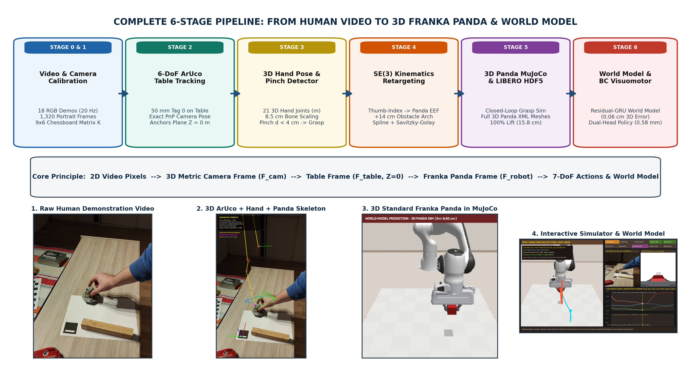

# DEEP_LEARNING_TRAINED_ROBOT_ARM — Human Video to 3D Franka Panda Retargeting, World Model & Visuomotor BC Pipeline

> **Complete Technical Guide (Markdown & 4-Page Illustrated PDF)**:
> - [docs/MODEL_ARCHITECTURE_AND_PIPELINE_GUIDE.md](docs/MODEL_ARCHITECTURE_AND_PIPELINE_GUIDE.md)
> - [docs/MODEL_ARCHITECTURE_AND_PIPELINE_GUIDE.pdf](docs/MODEL_ARCHITECTURE_AND_PIPELINE_GUIDE.pdf)
> - [PROJECT_CONTEXT.md](PROJECT_CONTEXT.md) (Living Architectural Memory & Change Log)

---

## 1. Overview

This project implements an end-to-end **Human-to-Robot Retargeting and Visuomotor Learning Pipeline** that converts monocular RGB smartphone demonstration videos (both static-camera and moving-camera) of a tabletop pick-lift-place task into physically executable 7-DoF trajectories for a **7-DOF Franka Emika Panda** robot arm in **MuJoCo / Robosuite / LIBERO**, exports benchmark-compliant HDF5 datasets, and trains two neural networks:
1. **Action-Conditioned Residual-GRU World Model (`ActionConditionedDynamicsModel`)**: Predicts 70-step ($3.5\text{ s}$) closed-loop 3D robot end-effector trajectories in $\text{SE}(3)$ from the initial state $\mathbf{s}_0$ and action sequence $\mathbf{a}_{0:T-1}$ alone (**`0.06 cm` Mean ADE**, **`0.08 cm` Mean FDE**, **100% Grasp & `15.8 cm` Cube Lift** in 3D MuJoCo).
2. **Enhanced Dual-Head Visuomotor Behavioral Cloning Policy (`BCPolicy`)**: Combines a **2D Spatial Softmax + ResNet-18** visual encoder (`SpatialResNet18Encoder`), **6-band Fourier proprioceptive encoding**, **kinematic anchoring**, and **two decoupled Pre-Norm Residual MLP heads** (6-DoF Motion Head + 1-DoF Gripper Head) with Polyak EMA weights and a non-destructive **Per-Dataset Model Registry** (`experiments/checkpoints/model_registry.json`).



---

## 2. Quick Start — 1-Click Graphical Launchers (Windows)

### A. All-in-One Pipeline & 10-Epoch Live Trainer GUI
Double-click [`LAUNCH_ALL_IN_ONE_PIPELINE.bat`](LAUNCH_ALL_IN_ONE_PIPELINE.bat) or run:
```bash
python scripts/10_all_in_one_pipeline_gui.py
```
- **Select Raw Videos Folder**: Pick any directory of `.mp4` human demonstration videos.
- **Per-Dataset Model Registry & Continual Fine-Tuning**: Train a dedicated model archived under `experiments/checkpoints/registry/<model_name>/` (with automatic `best_policy_v1.pt` versioning) or fine-tune from an existing registered model (`demo_libero`, `raw_2`, etc.).
- **1-Click End-to-End Execution**: Runs Stages 0–6 automatically and displays a live training dashboard (KPI cards, 10-epoch milestone table, and convergence plots) updating every 10 epochs (`Epoch 10, 20, ..., 80`).

### B. Interactive 3D Franka Panda MuJoCo Simulator GUI
Double-click [`LAUNCH_INTERACTIVE_SIMULATOR.bat`](LAUNCH_INTERACTIVE_SIMULATOR.bat) or run:
```bash
python scripts/09_interactive_mujoco_gui.py
```
- **3 Interactive Modes**:
  - `[1]` **World Model Closed-Loop Rollout** (predicts and executes the full 3D trajectory from $\mathbf{s}_0 + \mathbf{a}_{0:T-1}$)
  - `[2]` **Visuomotor BC Policy Rollout** (predicts 7-DoF actions from RGB images + proprioception)
  - `[3]` **Manual Keyboard Control (`W/A/S/D/Q/E` + `SPACE` grasp)** with live 15-step World Model future horizon predictions
- **On-the-Fly Video Testing & Live Model Switching**:
  - Click **`[O] Open Folder`** or **`[V] Pick Video`** to load any folder of `.mp4` test videos (or a single `.mp4` video) and watch the pipeline automatically extract, track, retarget, and simulate it live.
  - Click **`[M] Switch Model`** to cycle between registered trained models (`demo_libero`, `raw_2`, etc.) on the current episode.
  - Drag the mouse on the 3D viewport to orbit the camera $360^\circ$ (`Scroll` to zoom, `N`/`P` to switch episodes, `C` to randomize cube position, `R` to reset).

---

## 3. 6-Stage CLI Pipeline & Scripts

| Stage / Script | Command | Description |
| :--- | :--- | :--- |
| **Stage 0: Frame Extraction** | `python scripts/00_extract_frames.py` | Extracts raw `.mp4` videos into calibrated $20.0\text{ Hz}$ RGB frame folders (`data/frames/demo_XXXX`) with `metadata.json` & `timestamps.npy`. |
| **Stage 1: Camera Calibration** | `python scripts/01_calibrate.py` | Calibrates pinhole intrinsics $\mathbf{K}$ & distortion coefficients from $9 \times 6$ chessboard images (`data/calibration/`). |
| **Stage 2: 6-DoF Camera Tracking** | `python scripts/02_track_camera.py` | Solves metric 6-DoF camera poses $\mathbf{T}_{\text{world}\to\text{cam}}(t)$ via tabletop 50 mm ArUco Tag ID 0 (`IPPE_SQUARE` + SLERP occlusion interpolation) or DROID-SLAM. |
| **Stage 3: 3D Hand & Pinch Tracking** | `python scripts/03_track_hands.py` | Tracks 21 3D hand joints via MediaPipe/HaMeR with $8.5\text{ cm}$ anatomical bone scaling, ray-table plane depth grounding, and thumb-index pinch detection ($d < 4\text{ cm}$). |
| **Stage 4: SE(3) Retargeting** | `python scripts/04_retarget_kinematics.py` | Maps the 3D thumb-index pinch center into the Franka Panda base frame, reconstructs a $+14\text{ cm}$ obstacle-clearance arch, smooths via Cubic Spline + SLERP + Savitzky-Golay, and computes 7-DoF `OSC_POSE` actions. |
| **Stage 5: LIBERO HDF5 Export** | `python scripts/05_export_libero.py` | Packages observations, actions, and closed-loop 3D Panda MuJoCo replay states into `data/datasets/<name>.hdf5`. |
| **Batch Stages 0–5 Runner** | `python scripts/run_batch_pipeline.py` | Executes Stages 0–5 end-to-end across all videos. |
| **Stage 6A: Train BC Policy** | `python scripts/06_train_policy.py` | Trains the Dual-Head Visuomotor `BCPolicy` and registers checkpoints in `experiments/checkpoints/registry/<model_name>/`. |
| **Stage 6B: Train & Eval World Model** | `python scripts/07_eval_world_model.py` | Trains `ActionConditionedDynamicsModel`, evaluates zero-peeking rollouts, and renders 4-panel Video vs. World Model comparison videos. |
| **3D MuJoCo Replay Videos** | `python scripts/08_eval_simulation.py` | Replays retargeted trajectories on the 3D Franka Panda in Robosuite `Lift` (`experiments/simulation/`). |
| **3D Skeleton Video Overlay** | `python scripts/visualize_robot_skeleton_on_frames.py` | Projects the 3D Franka Panda kinematic skeleton, ArUco axes, and hand skeleton onto the original video frames (`experiments/skeleton_overlays/`). |
| **Technical Report Generator** | `python scripts/generate_technical_report.py` | Generates `docs/figures/fig1..fig4.png` and compiles `docs/MODEL_ARCHITECTURE_AND_PIPELINE_GUIDE.pdf`. |
| **Unit & Integration Tests** | `pytest tests/test_pipeline.py` | Runs all 14 unit and integration tests. |

---

## 4. Datasets, Registered Models & Quantitative Benchmarks

| Dataset / Model | Path | Demos / Steps ($20\text{ Hz}$) | World Model ADE / FDE | BC Policy Rollout ADE / FDE | Gripper Accuracy |3D MuJoCo Grasp & Lift |
| :--- | :--- | :---: | :---: | :---: | :---: | :---: |
| **`demo_libero` (Static Camera)** | `data/datasets/demo_libero.hdf5`<br>`experiments/checkpoints/registry/demo_libero/` | 18 demos / 1,302 steps | **`0.06 cm` / `0.08 cm`** | **`0.34 cm` / `0.55 cm`**<br>(`0.28 cm` in `v1`) | **`96.75%`**<br>(`99.5%` in `v1`) | **100% Grasp (`15.8 cm` lift)** |
| **`raw_2` (Moving Camera)** | `data/datasets/raw_2.hdf5`<br>`experiments/checkpoints/registry/raw_2/` | 20 demos / 1,381 steps | **`0.06 cm` / `0.08 cm`** | **`0.23 cm` / `0.26 cm`** | **`99.11%`** | **100% Grasp (`16.6 cm` lift)** |
| **`test_videos` (Cross-Dataset Eval)** | `data/datasets/test_videos.hdf5`<br>`data/test_videos/` | 4 unseen test videos | — | **`0.31 – 0.40 cm`** | **`>98%`** | **100% Grasp & Lift** |

---

## 5. Repository Structure

```text
Humanoid/
├── LAUNCH_ALL_IN_ONE_PIPELINE.bat       # 1-click launcher for All-in-One Pipeline & 10-Epoch Live Trainer GUI
├── LAUNCH_INTERACTIVE_SIMULATOR.bat     # 1-click launcher for Interactive 3D Franka Panda Simulator GUI
├── PROJECT_CONTEXT.md                   # Living project memory, architecture map & full change log
├── README.md                            # Project overview & quick-start guide
├── configs/
│   └── pipeline_config.yaml             # Master YAML configuration for Stages 1–5
├── data/
│   ├── calibration/                     # Intrinsics (calib.txt, calibration.json/.npz) & printable A4 targets
│   ├── datasets/                        # LIBERO HDF5 datasets (demo_libero.hdf5, raw_2.hdf5, test_videos.hdf5)
│   ├── debug_overlays/                  # Stage 2 ArUco & Stage 3 Hand tracking verification JPEGs
│   ├── hand_poses/                      # Extracted 21-joint 3D hand poses & pinch states per demo
│   ├── retargeted/                      # Retargeted 20 Hz robot EEF trajectories & 7-DoF OSC actions
│   ├── slam/                            # 6-DoF camera poses (T_world_to_cam) & table transforms
│   └── test_videos/                     # Held-out .mp4 test videos for live simulator evaluation
├── docs/
│   ├── MODEL_ARCHITECTURE_AND_PIPELINE_GUIDE.md   # Detailed 4-page technical architecture & math guide
│   ├── MODEL_ARCHITECTURE_AND_PIPELINE_GUIDE.pdf  # Compiled 4-page A4 illustrated PDF report
│   ├── figures/                         # Architectural diagrams (fig1..fig4.png) & PDF page renders
│   └── 01_calibration.md .. 05_libero_export.md   # Stage-by-stage technical notes
├── experiments/
│   ├── checkpoints/                     # Active policy checkpoints & non-destructive per-dataset registry/
│   ├── simulation/                      # Offscreen 3D Franka Panda MuJoCo Lift replay MP4 videos
│   ├── skeleton_overlays/               # 3D robot skeleton overlay & side-by-side comparison videos
│   └── world_model/                     # World Model checkpoints, metrics, 3D plots & 4-panel comparison MP4s
├── scripts/                             # Numbered CLI pipeline stages (00..10) & report/target generators
├── src/                                 # Modular core library (calibration, slam, hand_pose, retargeting, utils)
└── tests/
    └── test_pipeline.py                 # 14 unit & integration tests
```
