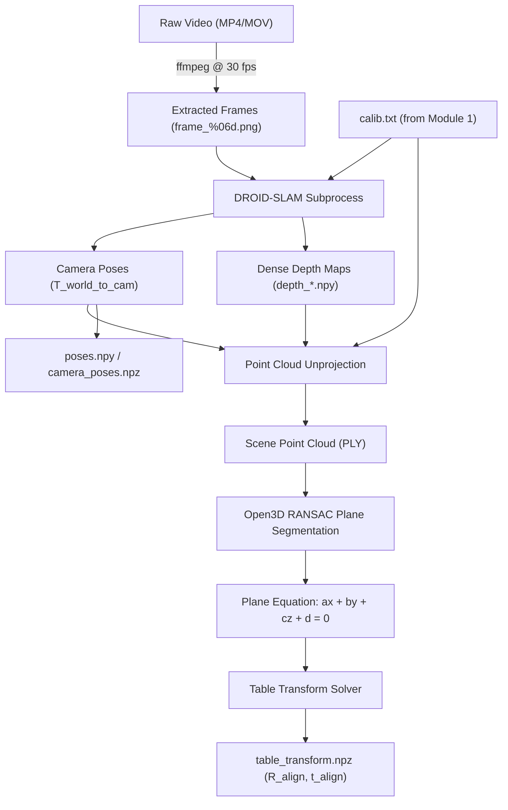

# Module 2: Visual SLAM & Table Plane Extraction Guide

This guide details the operation of **Module 2: Visual SLAM and Table Plane Extraction** in the **Egocentric Video to LIBERO Retargeting Pipeline**. This stage tracks the 6-DoF trajectory of an egocentric camera moving through an unconstrained environment, recovers a dense or semi-dense 3D scene point cloud, fits the physical tabletop plane via RANSAC, and constructs an invariant coordinate frame where the workspace table sits at $Z = 0.0$ with its normal aligned to the $+Z$ axis.

The implementation is located in [`camera_tracking.py`](file:///C:/Users/marti/Desktop/Humanoid/camera_tracking.py) and configured via [`configs/pipeline_config.yaml`](file:///C:/Users/marti/Desktop/Humanoid/configs/pipeline_config.yaml).

---

## 1. System Architecture Overview



```

---

## 2. Tabletop ArUco Tracking (Recommended & Default)

To achieve millimeter-precision tracking and eliminate metric scale ambiguity, place an **ArUco Tag ID 0 (Original ArUco Format)** flat on the tabletop surface.

### Advantages of Tabletop ArUco Tracking
* **Ground-Truth Plane Definition**: Because the tag lies on the table surface, the table plane is known analytically: $Z = 0$, with upward normal $[0, 0, 1]$. No RANSAC fitting or depth map back-projection needed.
* **Exact Metric Scale**: The physical marker size (e.g. 50 mm = 0.05 m) provides absolute ground-truth scale for every single frame via `cv2.solvePnP`.
* **Zero Dependencies on Windows**: Bypasses Linux-only SLAM compilation requirements (`lietorch`).

### Usage
```bash
python scripts/02_track_camera.py \
    --frames_dir data/frames/demo_0000 \
    --calib_txt data/calibration/calib.txt \
    --output_dir data/slam \
    --aruco_id 0 \
    --marker_size 0.05 \
    --aruco_dict DICT_ARUCO_ORIGINAL \
    --save_debug
```

---

## 3. Alternative: Monocular DROID-SLAM Setup (Markerless)

[DROID-SLAM](https://github.com/princeton-vl/DROID-SLAM) (Deep Recurrent Optical Flow for Image-based Dense SLAM) uses recurrent neural networks with dense visual bundle adjustment to estimate drift-free camera poses and inverse depth maps from monocular RGB video.

### Prerequisites & Submodule Installation
1. Clone DROID-SLAM into the `third_party/` directory:
   ```bash
   git clone --recursive https://github.com/princeton-vl/DROID-SLAM third_party/DROID-SLAM
   ```
2. Build `lietorch` and DROID-SLAM extensions (requires CUDA Toolkit $\ge 11.8$ matching your PyTorch build):
   ```bash
   cd third_party/DROID-SLAM
   python setup.py install
   cd ../..
   ```
3. Download the pre-trained model weights:
   ```bash
   python -c "
   import urllib.request
   url = 'https://droppr.s3.amazonaws.com/droid.pth'
   urllib.request.urlretrieve(url, 'third_party/DROID-SLAM/droid.pth')
   print('DROID-SLAM weights downloaded successfully.')
   "
   ```

---

## 3. Video Preprocessing: Frame Extraction at 30 FPS

Input egocentric videos (from wearable glasses, chest harnesses, or head-mounted GoPro cameras) must be extracted as an ordered PNG sequence at a consistent **30.0 frames per second**:

```bash
# Create frames target folder
mkdir -p data/frames

# Extract lossless PNG frames with 6-digit zero padding
ffmpeg -i data/raw_video.mp4 -r 30 -q:v 1 data/frames/frame_%06d.png
```

> [!TIP]
> Ensure frames are numbered lexicographically (`frame_000001.png`, `frame_000002.png`, etc.) so that file system sorting matches sequential temporal order.

---

## 4. Running Camera Tracking & Plane Fitting

Execute [`camera_tracking.py`](file:///C:/Users/marti/Desktop/Humanoid/camera_tracking.py):

```bash
python camera_tracking.py \
    --frames_dir data/frames \
    --calib_txt outputs/calibration/calib.txt \
    --output_dir outputs/camera_tracking \
    --slam_script third_party/DROID-SLAM/demo.py \
    --visualize
```

### CLI Parameters Reference

| Argument | Type | Default | Description |
| :--- | :--- | :--- | :--- |
| `--frames_dir` | `Path` | *(Required)* | Directory of extracted sequential PNG/JPG frames. |
| `--calib_txt` | `Path` | *(Required)* | Camera intrinsic file generated by Module 1 (`fx fy cx cy`). |
| `--output_dir` | `Path` | *(Required)* | Root directory for poses, point clouds, and transforms. |
| `--slam_script` | `Path` | `./third_party/DROID-SLAM/demo.py` | Entry point script for DROID-SLAM. |
| `--visualize` | `flag` | `False` | Opens an interactive Open3D window displaying point cloud and table plane. |

---

## 5. Geometric Principles & Algorithmic Steps

### Step 1: Loading Poses
DROID-SLAM produces camera poses formatted either as $4 \times 4$ homogeneous SE(3) transformation matrices:

$$\mathbf{T}_{\text{world}\to\text{cam}} = \begin{bmatrix} \mathbf{R} & \mathbf{t} \\ \mathbf{0}^T & 1 \end{bmatrix} \in \mathbb{SE}(3)$$

or as position + quaternion vectors $[t_x, t_y, t_z, q_x, q_y, q_z, q_w]$. [`camera_tracking.py`](file:///C:/Users/marti/Desktop/Humanoid/camera_tracking.py) standardizes these into a continuous array of shape $(N, 4, 4)$.

### Step 2: 3D Point Cloud Reconstruction
If DROID-SLAM exports per-frame inverse depth maps $D_i(u, v)$, 3D point coordinates in camera frame are computed:

$$z = D_i(u, v), \quad x = \frac{(u - c_x) \cdot z}{f_x}, \quad y = \frac{(v - c_y) \cdot z}{f_y}$$

Points are mapped to the SLAM world frame using the camera-to-world transform $\mathbf{T}_{\text{cam}\to\text{world}} = \mathbf{T}_{\text{world}\to\text{cam}}^{-1}$:

$$\mathbf{p}_{\text{world}} = \mathbf{T}_{\text{cam}\to\text{world}} \begin{bmatrix} x \\ y \\ z \\ 1 \end{bmatrix}$$

### Step 3: RANSAC Table Plane Fitting
Using Open3D's `segment_plane`, points are sampled to solve the plane equation:

$$a x + b y + c z + d = 0, \quad \text{with } \|\mathbf{n}\| = \sqrt{a^2 + b^2 + c^2} = 1$$

* **Distance Threshold**: $10\text{ mm}$ ($0.01\text{ m}$) — points within $1\text{ cm}$ of the plane candidate are treated as inliers.
* **Sample Count ($n$)**: $3$ points minimum to define a unique spatial plane.
* **Iterations**: $1000$ iterations to guarantee $> 99.9\%$ probability of sampling an all-inlier consensus set.

```python
plane_model, inliers = pcd.segment_plane(
    distance_threshold=0.01,
    ransac_n=3,
    num_iterations=1000,
)
a, b, c, d = plane_model
```

### Step 4: Table-to-World Alignment Transform
To map the table plane to lie flat on the horizontal XY plane at $Z = 0.0$:

1. **Upward Normal Enforcement**:
   If the plane normal component $c < 0$, invert the parameters so that the normal vector points upwards:
   $$\mathbf{n} \leftarrow -\mathbf{n}, \quad d \leftarrow -d$$
2. **Rodrigues' Rotation Alignment**:
   Compute the rotation $\mathbf{R}_{\text{align}}$ that rotates normal $\mathbf{n} = [a, b, c]^T$ to $\hat{\mathbf{z}} = [0, 0, 1]^T$:
   $$\mathbf{v} = \mathbf{n} \times \hat{\mathbf{z}}, \quad s = \|\mathbf{v}\|, \quad c_{\text{dot}} = \mathbf{n} \cdot \hat{\mathbf{z}}$$
   $$\mathbf{R}_{\text{align}} = \mathbf{I} + [\mathbf{v}]_{\times} + [\mathbf{v}]_{\times}^2 \frac{1 - c_{\text{dot}}}{s^2}$$
3. **Z-Origin Translation**:
   The distance from the world origin to the plane along $\mathbf{n}$ is $d$. Translating by $t_z = d$ ensures the table surface sits exactly at $Z = 0.0$:
   $$\mathbf{t}_{\text{align}} = [0, 0, d]^T$$

For any 3D point $\mathbf{p}$ on the table surface:
$$\mathbf{p}' = \mathbf{R}_{\text{align}} \mathbf{p} + \mathbf{t}_{\text{align}} \implies p'_z \approx 0.0$$

---

## 6. Output Files Specification

The module writes three artifacts inside `--output_dir`:

### 1. `poses.npy` / `camera_poses.npz`
Contains the per-frame $(N, 4, 4)$ SE(3) camera poses:
```python
import numpy as np
poses = np.load("outputs/camera_tracking/poses.npy")
print(poses.shape)  # e.g., (450, 4, 4) float64
```
* Key `T_world_to_cam`: Homogeneous transformation from world coordinate frame to camera optical frame.

### 2. `table_transform.npz`
Contains the rigid transform mapping the detected table plane to $Z=0$:
* `R_align`: $(3, 3)$ `float64` rotation matrix.
* `t_align`: $(3,)$ `float64` translation vector $[0, 0, d]$.
* `plane_model`: $(4,)$ `float64` coefficients $[a, b, c, d]$.

### 3. `scene_pointcloud.ply`
Dense 3D scene point cloud in Stanford PLY format. Can be directly loaded and inspected in MeshLab, CloudCompare, or Open3D:
```python
import open3d as o3d
pcd = o3d.io.read_point_cloud("outputs/camera_tracking/scene_pointcloud.ply")
o3d.visualization.draw_geometries([pcd])
```

---

## 7. Verification & Troubleshooting

### Visual Inspection with Open3D
When passing `--visualize`, [`camera_tracking.py`](file:///C:/Users/marti/Desktop/Humanoid/camera_tracking.py) renders:
* Inlier table points colored in **Green**.
* Outlier scene points colored in **Light Gray**.
* Camera trajectory represented by a connected line strip and coordinate axes at each keyframe.
* Transformed table surface with a large horizontal plane wireframe at $Z = 0$.

### Common Issues and Solutions
* **Issue: "No depth maps or bundled point cloud found"**
  * *Reason*: DROID-SLAM was executed without depth export or ran out of VRAM.
  * *Solution*: The module automatically falls back to fitting a plane through camera centers. For accurate manipulation, ensure GPU memory is sufficient for DROID-SLAM depth extraction (minimum 8 GB VRAM recommended).
* **Issue: Flipped Table Surface ($Z < 0$)**
  * *Reason*: Inverted normal detection.
  * *Solution*: The algorithm checks $n_z < 0$ and flips $\mathbf{n}$. Ensure the table has sufficient visible inliers and is not occluded by the user's torso.
