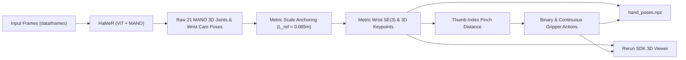

# Module 3: 3D Hand Pose & Gripper State Estimation Guide

This guide details **Module 3: 3D Hand Pose & Gripper State Estimation** within the **Egocentric Video to LIBERO Retargeting Pipeline**. This stage extracts dense 3D articulating hand keypoints, wrist SE(3) transforms in the camera frame, enforces physical metric scale using anatomical priors, and computes continuous and binary gripper actions for robotic end-effector control.

The module is implemented in [`hand_tracking.py`](file:///C:/Users/marti/Desktop/Humanoid/hand_tracking.py) and configured via [`configs/pipeline_config.yaml`](file:///C:/Users/marti/Desktop/Humanoid/configs/pipeline_config.yaml).

---

## 1. System Overview



---

## 2. HaMeR Setup & MANO Model

[HaMeR](https://github.com/geopavlakos/hamer) (Hand Mesh Recovery) is a state-of-the-art vision transformer foundation model that reconstructs 3D hand meshes and joints from unconstrained RGB images.

### Installation
1. Clone HaMeR into `third_party/`:
   ```bash
   git clone https://github.com/geopavlakos/hamer third_party/hamer
   cd third_party/hamer
   pip install -e .
   cd ../..
   ```
2. Download MANO model files:
   Register and download the MANO models (`MANO_LEFT.pkl`, `MANO_RIGHT.pkl`) from the [MANO website](https://mano.is.tue.mpg.de/) and place them under `third_party/hamer/_DATA/data/mano/`.
3. Download HaMeR checkpoint:
   ```bash
   mkdir -p third_party/hamer/hamer_ckpts
   # Follow instructions in HaMeR README to fetch hamer_vit_b.pth
   ```

---

## 3. MANO 21-Joint Topology

The parametric MANO hand model outputs 21 distinct anatomical joint locations in 3D:

```
                  (4) Thumb Tip
                    \
                    (3) IP
                     \
                     (2) MCP
                      \
                      (1) CMC
                        \
  [Wrist] (0) -------- (5) MCP - (6) PIP - (7) DIP - (8) Index Tip
            \
             \------- (9) MCP - (10) PIP - (11) DIP - (12) Middle Tip
              \
               \----- (13) MCP - (14) PIP - (15) DIP - (16) Ring Tip
                \
                 \--- (17) MCP - (18) PIP - (19) DIP - (20) Pinky Tip
```

Key indices utilized in our pipeline:
* **Joint 0**: Wrist Root ($\mathbf{p}_{\text{wrist}}$)
* **Joint 4**: Thumb Fingertip ($\mathbf{p}_{\text{thumb}}$)
* **Joint 8**: Index Fingertip ($\mathbf{p}_{\text{index}}$)
* **Joint 9**: Middle Metacarpophalangeal (MCP) Joint ($\mathbf{p}_{\text{middle\_mcp}}$)

---

## 4. Metric Scale Anchoring ($L_{\text{ref}} = 0.085\text{ m}$)

### The Monocular Scale Ambiguity Problem
Neural hand reconstruction models trained on monocular RGB images output hand geometry in an arbitrary, ungrounded scale or normalized camera frame. Without absolute metric scale, the robot cannot execute precise pick-and-place trajectories without colliding or undershooting.

### Anatomical Distance Invariance
Across adult humans, the Euclidean bone length from the wrist center (Joint 0) to the middle finger knuckle (Joint 9, Middle MCP) exhibits minimal variance, with a standard population baseline:

$$L_{\text{ref}} = 0.085\text{ metres } (8.5\text{ cm})$$

### Solving for Per-Frame Metric Scale
For each video frame $t$:
1. Measure the predicted Euclidean distance between Joint 0 and Joint 9:
   $$d_{\text{pred}, t} = \|\mathbf{p}_{9, t} - \mathbf{p}_{0, t}\|_2$$
2. Compute the metric correction scale factor $s_t$:
   $$s_t = \frac{L_{\text{ref}}}{d_{\text{pred}, t}} = \frac{0.085}{\|\mathbf{p}_{9, t} - \mathbf{p}_{0, t}\|_2}$$
3. Scale all 21 joint coordinates and the wrist translation vector $\mathbf{t}_{\text{wrist}, t}$ into true metric space:
   $$\mathbf{P}_{\text{metric}, t} = s_t \cdot \mathbf{P}_{\text{raw}, t}$$
   $$\mathbf{t}_{\text{cam}\to\text{hand}, t}^{\text{metric}} = s_t \cdot \mathbf{t}_{\text{cam}\to\text{hand}, t}^{\text{raw}}$$

This guarantees that physical hand displacements correspond directly to SI meters in the robot workspace.

---

## 5. Gripper State Estimation: Pinch Distance

In egocentric manipulation, humans grasp objects predominantly using precision or power pinches between the index finger and thumb.

### Pinch Distance Calculation
Compute the 3D metric Euclidean distance between thumb tip and index tip:

$$d_{\text{pinch}, t} = \|\mathbf{p}_{4, t}^{\text{metric}} - \mathbf{p}_{8, t}^{\text{metric}}\|_2$$

### 1. Binary Gripper Action
Used by standard Robosuite and LIBERO benchmark tasks (where $-1.0 = \text{Open}$, $+1.0 = \text{Closed}$):

$$a_{\text{binary}, t} = \begin{cases} 
+1.0 & \text{if } d_{\text{pinch}, t} \le \tau_{\text{pinch}} \quad (\text{Closed / Grasping}) \\
-1.0 & \text{if } d_{\text{pinch}, t} > \tau_{\text{pinch}} \quad (\text{Open / Releasing})
\end{cases}$$

Default threshold: $\tau_{\text{pinch}} = 0.04\text{ m}$ ($40\text{ mm}$).

### 2. Continuous Gripper Aperture
Normalized continuous signal $g_t \in [0.0, 1.0]$ representing normalized closing proportion:

$$g_t = \text{clip}\left(1.0 - \frac{d_{\text{pinch}, t} - d_{\text{min}}}{d_{\text{max}} - d_{\text{min}}}, 0.0, 1.0\right)$$

where $d_{\text{min}} = 0.015\text{ m}$ ($15\text{ mm}$) and $d_{\text{max}} = 0.085\text{ m}$ ($85\text{ mm}$).

---

## 6. Running Hand Tracking

Execute [`hand_tracking.py`](file:///C:/Users/marti/Desktop/Humanoid/hand_tracking.py):

```bash
python hand_tracking.py \
    --frames_dir data/frames \
    --output_dir outputs/hand_tracking \
    --hamer_script third_party/hamer/demo.py \
    --pinch_threshold 0.04 \
    --visualize
```

### CLI Arguments Reference

| Argument | Type | Default | Description |
| :--- | :--- | :--- | :--- |
| `--frames_dir` | `Path` | *(Required)* | Directory containing input RGB frames (`*.png` / `*.jpg`). |
| `--output_dir` | `Path` | *(Required)* | Directory for HaMeR intermediates and `hand_poses.npz`. |
| `--hamer_script` | `Path` | `./third_party/hamer/demo.py` | Path to HaMeR entry-point script. |
| `--pinch_threshold` | `float` | `0.04` | Thumb-to-index distance threshold in meters. |
| `--visualize` | `flag` | `False` | Launches real-time 3D visualization using the Rerun SDK. |

---

## 7. 3D Temporal Visualization with Rerun SDK

When `--visualize` is specified, the script initializes a [Rerun](https://rerun.io/) temporal stream:

* **Skeletal Rig**: Renders the 21 MANO 3D joints and connected bones across time.
* **Wrist Frame**: 3D RGB coordinate axes showing wrist orientation ($\mathbf{R}_{\text{cam}\to\text{hand}}$).
* **Pinch Distance Metric Curve**: Time-series scalar plot displaying $d_{\text{pinch}}$ alongside the threshold line at $0.04\text{ m}$.
* **Gripper Action**: Binary indicator displaying real-time grasp and release transitions.

```python
import rerun as rr

rr.init("hand_tracking_viewer", spawn=True)
rr.log("world/hand/skeleton", rr.Points3D(keypoints_metric, radii=0.005))
rr.log("world/hand/bones", rr.LineStrips3D(bone_segments))
rr.log("metrics/pinch_distance", rr.Scalar(d_pinch))
```

---

## 8. Output Specification: `hand_poses.npz`

The pipeline generates `outputs/hand_tracking/hand_poses.npz` with the following numpy arrays:

* `T_cam_to_hand`: $(N, 4, 4)$ `float64` array containing the metric 6-DoF SE(3) transform from the camera frame to the wrist joint.
* `keypoints`: $(N, 21, 3)$ `float64` array of all 21 MANO joints in metric camera coordinates.
* `gripper_continuous`: $(N,)$ `float64` array in range $[0.0, 1.0]$.
* `gripper_binary`: $(N,)$ `float64` array with values in $\{-1.0, +1.0\}$.
* `pinch_distances`: $(N,)$ `float64` array with raw thumb-to-index Euclidean distances in meters.
